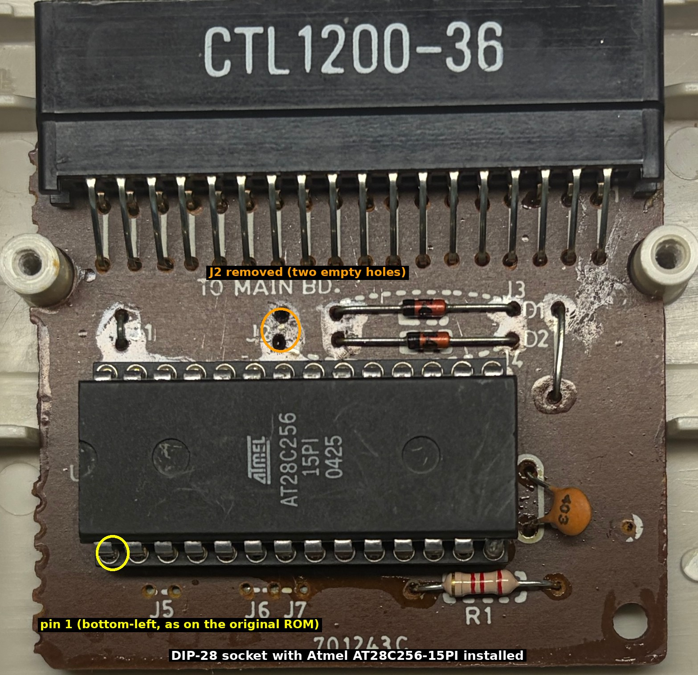
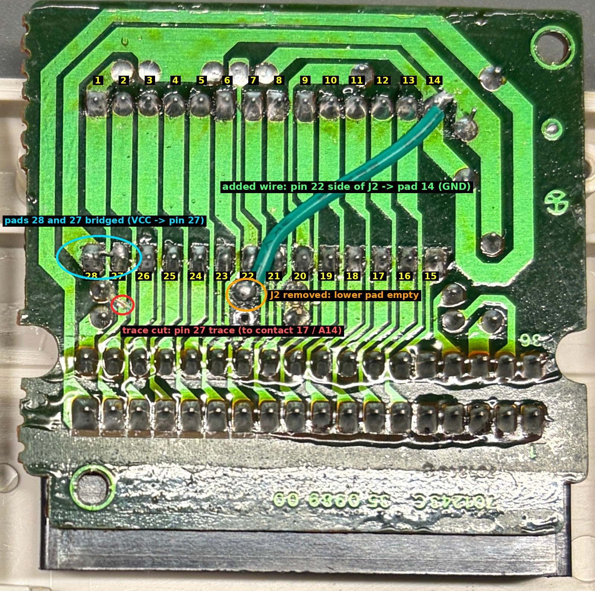

# vtech-genio2000-rom-dumper

Tools to read the internal firmware of the **Spanish VTech Genio 2000** from original hardware with a cartridge modification that lets you load the dumper from an AT28C256 EEPROM, and host software that receives the data over the printer port, checks it with CRC-16 and CRC-32, and rebuilds and validates the dump.





*The modified cartridge (PCB 701243C, from the "Inglés para principiantes" cartridge), component side with the DIP socket and AT28C256, and copper side: jumper J2 removed, one trace cut, pins 27 and 28 bridged, one added wire. See the [hardware guide](hardware/README.md).*

> The modification was made on the **"Inglés para principiantes"** cartridge. Other cartridges with a different jumper configuration (J1 to J7) or ROM may need different changes.

> **Status.** The method worked on the author's single Genio 2000 (2026-11-08). It has not been tried on other units,
> other firmware revisions or other VTech models. The repository does **not** contain VTech's firmware and never will.

## The machine

The VTech Genio 2000 is a Spanish educational laptop-style computer with a Z80 CPU, a character LCD, a keyboard,
a printer connector and a 36-contact cartridge slot. It belongs to the same family as the German *Genius Leader*
and the English *PreComputer* machines, whose homebrew scene is documented by the VGLDK project (see below). Related models are
mentioned only as history: **no compatibility with any other model is claimed or tested.**

## What it does

* **`bank_diag`, `bank_diag16`**: diagnostics that identify which content the CPU window `0x4000-0x7FFF` shows for each
  value written to the bank-select port `0x01`, with CRC-32 fingerprints. ([details](docs/PROGRAMS.md))
* **`bank_dump`**: sends the eight reachable 16 KiB banks (128 KiB) in 128-byte frames, each with a CRC-16, plus a CRC-32 of a
  second complete read of each bank, at 9600 baud over the printer-port data line.
* **Host tools** in `tools/`: live receivers, frame decoder, per-block cross-verification of independent sessions, and
  reconstruction of the candidate image. Damaged, missing or conflicting data is reported, never silently repaired.
* **Reproducible builds**: six release images with SHA-256 sums, rebuilt byte-for-byte from source.
* **99 automated tests** including a Z80 simulation of the actual cartridge images. No emulator is needed.

## Supported hardware

Only the **Spanish Genio 2000** used by the author, with the modified "Inglés para principiantes" cartridge. Anything else is untested.

### Potentially related models (NOT tested)

These machines belong to the same VTech family. They are listed as candidates for future testing only. **Compatibility of the cartridge programs, the bank-select port, the cartridge connector or the cartridge modification is not claimed for any of them.** The model and VTech reference numbers were supplied by the project owner and have not been independently verified here.

| Country / market | Commercial model | VTech reference |
|---|---|---|
| Spain | Genio 2000 (**the only model tested**) | 80-2258 |
| Germany | Genius Leader 4000 Quadro | 80-2044 |
| Germany | Genius Leader 4004 Quadro L | 80-2484 |
| France | Genius 4000 | 80-2003 |
| USA / UK | PreComputer Power Pad | 80-1913 (USA) |

## Requirements

*Hardware:* a Genio 2000; a cartridge modified for an AT28C256 (see [hardware guide](hardware/README.md)); an EEPROM programmer (XGecu TL866II Plus used, with an Atmel AT28C256-15PI);
a USB-serial adapter (CP2102 was used) connected to DATA0 (printer-port pin 2) and ground, with the adapter's TXD left unconnected.

*Software:* Linux (tested on Debian 13.7), SDCC 4.5.0, Python 3.13.5, pyserial 3.5 (receivers), pytest 8.3.5 (tests).

```bash
sudo apt install sdcc python3 python3-serial python3-pytest
```

## Quick start

```bash
git clone https://github.com/kresp0/vtech-genio2000-rom-dumper vtech-genio2000-rom-dumper && cd vtech-genio2000-rom-dumper
./build.sh all                                  # builds and checks the three programs
sha256sum -c release/SHA256SUMS                 # the images in release/ are the ones validated
python3 -m pytest -q -p no:cacheprovider tests  # about 80 s
```

Then program `release/bank_diag_AT28C256_32K.bin` into the EEPROM, insert the cartridge into the switched-off Genio, and:

```bash
python3 tools/bank_diag_rx.py --port /dev/ttyUSB0
```

Switch the Genio on and press ENTER at each stage prompt. The complete procedure, in the order the author followed it, is in the
[dumping guide](docs/DUMPING_GUIDE.md).

## Precompiled cartridge images

In `release/` (and on the GitHub Release page):

| File | Programs into |
|---|---|
| `bank_diag_AT28C256_32K.bin`, `bank_diag16_AT28C256_32K.bin`, `bank_dump_AT28C256_32K.bin` | **AT28C256 directly** (32 KiB: the 8 KiB image repeated four times) |
| `bank_diag.cart.8kb.bin`, `bank_diag16.cart.8kb.bin`, `bank_dump.cart.8kb.bin` | the raw 8 KiB cartridge image, for inspection or emulators; not the layout tested on hardware |

Each 32 KiB image was used in a recorded hardware session; the 8 KiB images were not tested on their own. See
[docs/BUILD.md](docs/BUILD.md) and `release/SHA256SUMS`.

## Dumping procedure in short

1. Build the modified cartridge and program `bank_diag` (hardware guide, dumping guide §4).
2. Run the diagnostic, read the result ([PROGRAMS.md](docs/PROGRAMS.md)).
3. Program `bank_dump`; run it **twice**, each in a separate session.
4. `python3 tools/bank_dump_verify.py dumps/dump/capture_A.bin dumps/dump/capture_B.bin`
5. Hash the result with `sha256sum`; compare with [the reference values](docs/HARDWARE_EVIDENCE.md).

## Verification and checksums

Every frame has a CRC-16; every bank also carries the CRC-32 of a second read; blocks are accepted only when two independent
sessions agree; banks only when their assembled CRC-32 matches. Release images have SHA-256 sums in `release/SHA256SUMS`.
The protocol is documented in [docs/PROTOCOL.md](docs/PROTOCOL.md), the tests in [docs/TESTING.md](docs/TESTING.md).

## Limitations

* One unit, one session day, one author. Not reproduced by anyone else yet.
* The cartridge modification is specific to the "Inglés para principiantes" cartridge (PCB 701243C, jumper configuration as photographed).
* The dump covers the **eight banks reachable through port-0x01 selectors 0 to 7** (131072 bytes). Selectors 8 to 15 and
  0x10 to 0x1F repeat them. **The physical capacity of the internal mask ROM is not determined**; bank selector bits 5 to 7 and ports
  0x02, 0x04 and 0x05 were never exercised.
* The cartridge modification is irreversible in practice and was documented from the author's photographs and
  design.
* Hardware runs have not been repeated in the preparation of this repository; the automated tests use simulation.
* Linux only; Debian 13 only tested.

## Licensing

Original code, **photographs, annotated images and diagrams by the author: GPL-3.0-or-later**, Copyright (C) 2026 Santiago Crespo (photographs: see [hardware/photos/README.md](hardware/photos/README.md); the unannotated originals are kept as the preferred source for modification). See [LICENSE](LICENSE) (GNU GPL v3 text), `SPDX-License-Identifier` headers in each file, and
[docs/LICENSE_AUDIT.md](docs/LICENSE_AUDIT.md). The cartridge images contain code from VGLDK and are distributed under GPL v3.
`third_party/vgldk/` holds seven unmodified VGLDK headers with their upstream license; see [third_party/README.md](third_party/README.md).

This is an independent project. It is **not affiliated with, endorsed by or sponsored by VTech**; "VTech", "Genio" and
"Genius Leader" are trademarks of their owners.

## Credits

* **VGLDK** (VTech Genius LEADER Development Kit) by Bernhard "HotKey" Slawik: <https://github.com/hotkeymuc/vgldk>.
  The cartridge start-up code, the LCD and keyboard definitions come from it.
* HotKey's Hackaday project on the Genius Leader / PreComputer family, whose "Bus Ficker" cartridge schematic was used to cross-check the
  connector pinout: <https://hackaday.io/project/166921-v-tech-genius-leader-precomputer-hacking>
* Datasheets used: Sharp LH531000B <https://www.qdatasheet.com/pdf-view/LH531000BN-S-Sharp.pdf>, Atmel AT28C256 <https://www.rcscomponents.kiev.ua/datasheets/AT28C256.pdf>.
* Original research, hardware modification, firmware and host software: the repository authors.

## Related projects and preservation

* VGLDK: <https://github.com/hotkeymuc/vgldk>
* MAME, which has drivers for several machines of this family (`pc2000.cpp`): <https://github.com/mamedev/mame>
* Internet Archive: no link is given here yet; add the URL of any upload of the dump or the cartridge images once the owner has one.

The firmware dump itself is VTech's copyrighted software and is not distributed here. If you have your own dump, preservation
organisations such as MAME can use its hashes ([reference values](docs/HARDWARE_EVIDENCE.md)) to identify it.

## Repository layout

```
build.sh            builds and checks the three programs
src/                cartridge programs (C, Z80 inline asm) and shared header
tools/              host-side receivers, decoder, verifier, build helpers
tests/              automated tests and the Z80 simulator
hardware/           cartridge modification guide, pinouts, photographs
docs/               programs, protocol, dumping guide, build, tests, evidence, license audit
release/            the six validated images, SHA256SUMS, release notes
third_party/vgldk/  seven unmodified VGLDK files and its license
```
