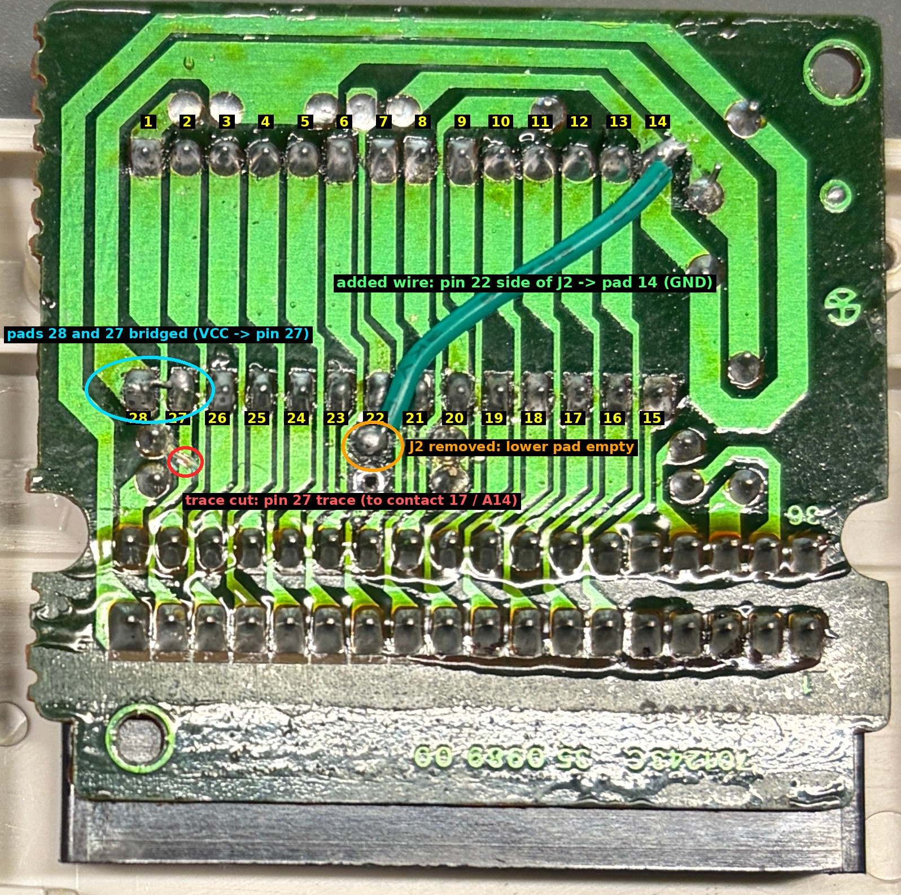
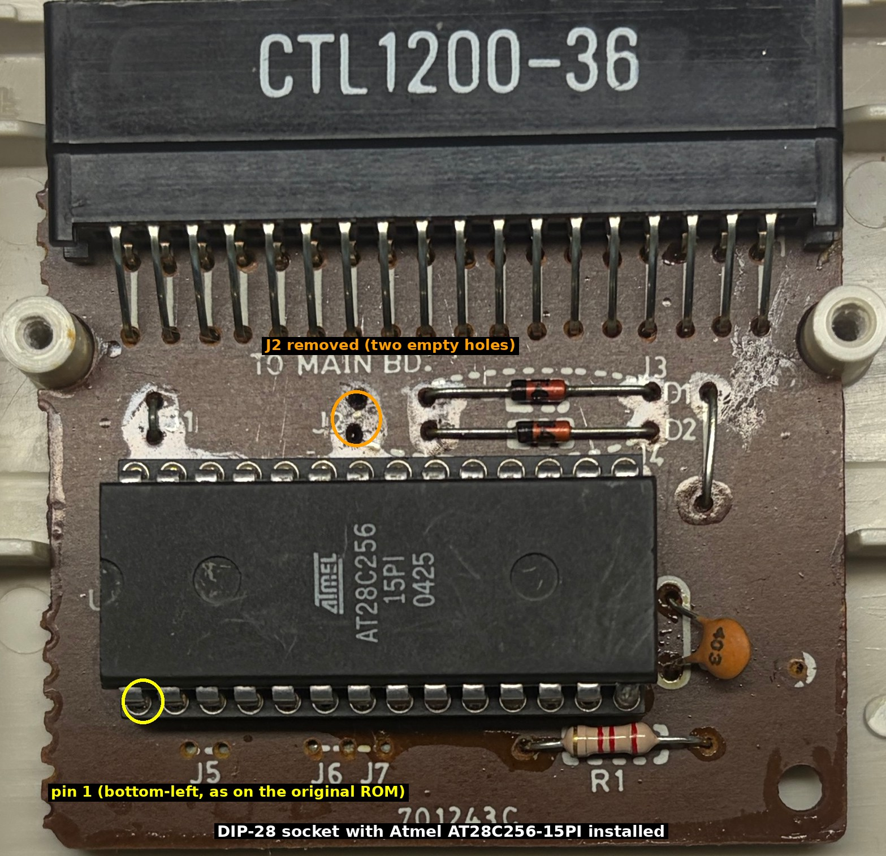
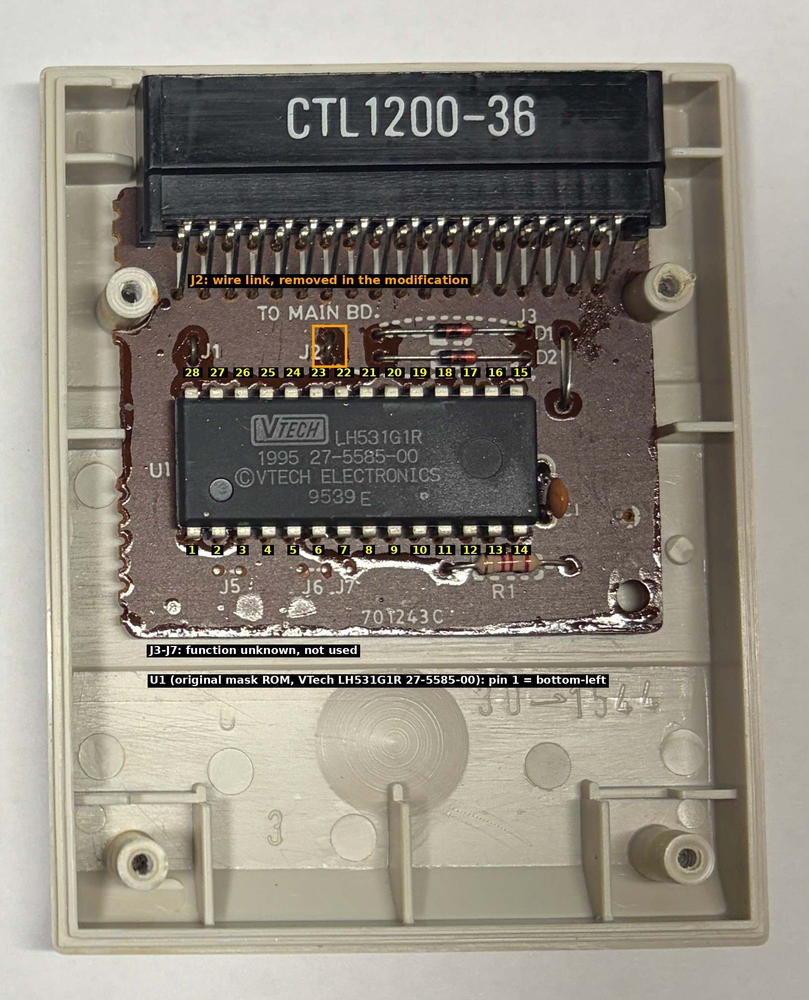

# Hardware guide: modifying cartridge PCB 701243C for an AT28C256 EEPROM

This guide describes the cartridge modification that was **actually built and used** to run the programs in this repository on a
Spanish VTech Genio 2000. It describes that one modification only. Other designs (interposer adapters, alternative jumper
schemes) were considered during the research but were never built or tested, so they are not documented here.

> **Scope.** The modification was made on the cartridge **"Inglés para principiantes"** (English for beginners; PCB 701243C, original ROM VTech LH531G1R 27-5585-00).
> **Other cartridges, with different jumper settings (J1 to J7) or a different ROM, may need different changes.** This guide is valid only for the board and the jumper
> configuration shown in the photographs; check the pads and links of your own cartridge before copying anything.

> **Warning.** The modification is irreversible in practice (a copper trace is cut). Use a cartridge you can afford to
> sacrifice. Everything below is provided as-is, without warranty. You are responsible for your own hardware.

## How to read this guide

Every statement carries one of these labels:

| Label | Meaning |
|---|---|
| **VERIFIED** | Visible in the author's photographs of the finished cartridge, or demonstrated by the cartridge having run the programs of this repository. |
| **MEASURED** | Measured by the author with a multimeter on the original cartridge, before modification. |
| **FROM DATASHEET** | Taken from the Sharp LH531000B or Atmel AT28C256 datasheet (links at the end). |
| **INFERRED** | A conclusion drawn from the evidence above, not directly checked. |
| **UNKNOWN** | Not known. |

The photographs in `photos/` are:

| File | Content |
|---|---|
| `cartridge_pcb_component_side_original.jpg` / `_annotated.jpg` | Original English-for-beginners cartridge, component side, original ROM fitted (before modification). |
| `cartridge_pcb_copper_side_original.jpg` | Same board, copper side, ROM removed (before modification). |
| `modified_cartridge_copper_side.jpg` / `_annotated.jpg` | Copper side after the modification. |
| `modified_cartridge_component_side.jpg` / `_annotated.jpg` | Component side after the modification: DIP-28 socket with the AT28C256 installed (rotated to match the other photographs). |





## 1. The original cartridge

* PCB marking **701243C** (VERIFIED, printed on the board), single-sided, with the 36-contact edge connector part
  **CTL1200-36** and the legend "TO MAIN BD." (VERIFIED, photograph).
* One mask ROM, position **U1**, 28-pin DIP, marked "VTECH LH531G1R 1995 27-5585-00 9539 E" (VERIFIED, photograph).
* Other parts visible on the board: diodes **D1, D2**, resistor **R1** (colour bands red-red-red, i.e. 2.2 kΩ), ceramic
  capacitor **C1**, and wire links **J1** and **J2** fitted; pads **J3 to J7** are present, and J5 to J7 are unpopulated
  (VERIFIED, photograph). The function of J1 and J3 to J7 is **UNKNOWN**.
* The ROM is not a standard part number: VTech marks its own mask ROMs. **There is no public datasheet for LH531G1R**
  (UNKNOWN). Its pinout was matched against the Sharp **LH531000B** (1 Mbit, 128K × 8, 28 pins): seven pins measured
  by the author (see below) agree with that pinout in every case. This makes it **INFERRED** that the cartridge ROM
  uses the LH531000B pinout.



### Original ROM pinout (INFERRED from the LH531000B datasheet, seven pins MEASURED)

Pin 1 is at the bottom left of the ROM in the component-side photograph. Pins 1 to 14 run along the bottom edge from left
to right, pins 15 to 28 along the top edge from right to left.

| Pin | Signal | Pin | Signal |
|---|---|---|---|
| 1 | A15 (MEASURED to contact 19) | 28 | VCC (MEASURED to contact 34 and C1) |
| 2 | A12 (MEASURED to contact 20) | 27 | **A14** (MEASURED to contact 17) |
| 3 | A7 | 26 | A13 (MEASURED to contact 16) |
| 4 | A6 | 25 | A8 |
| 5 | A5 | 24 | A9 |
| 6 | A4 | 23 | A11 |
| 7 | A3 | 22 | **A16** (MEASURED to contact 12, through J2) |
| 8 | A2 | 21 | A10 |
| 9 | A1 | 20 | CE/OE, active level set by mask (datasheet); wired to R1, D1 and D2 (MEASURED) |
| 10 | A0 | 19 | D7 |
| 11 | D0 | 18 | D6 |
| 12 | D1 | 17 | D5 |
| 13 | D2 | 16 | D4 |
| 14 | GND (MEASURED to contact 18) | 15 | D3 |

The ROM has seventeen address lines (A0 to A16) in this socket. Only A0 to A13 come from the CPU address bus; A14, A15 and
A16 are bank-select lines supplied by the Genio through the connector (INFERRED, see `PINOUT_36.md`).

## 2. The 36-contact connector

See [PINOUT_36.md](PINOUT_36.md) for the complete table with a confidence level per contact. Short version: the author
measured seven ROM pins against the connector and all seven agree with the independently published netlist of HotKey's
"Bus Ficker" cartridge for the Genius Leader 4000/6000SL. The remaining contacts are taken from that netlist
(INFERRED for the Genio 2000). Contacts 1 to 4, 35 and 36 have **UNKNOWN** function on this machine.

## 3. The AT28C256 and why it does not fit as is

The **Atmel AT28C256** is a 32K × 8 parallel EEPROM in a 28-pin DIP, 5 V, read access time 150 ns for the -15 grade
(FROM DATASHEET). The pins that differ from the ROM socket:

| Socket pin | Cartridge signal (ROM) | AT28C256 function | Consequence if inserted unmodified (INFERRED) |
|---|---|---|---|
| 1 | A15 | **A14** | EEPROM would be addressed with the wrong line. This is intended to stay as it is, see below. |
| 22 | A16 | **/OE** (output enable) | Outputs are disabled whenever the bank logic drives A16 high: reads fail. |
| 27 | A14 | **/WE** (write enable) | /WE follows a bank-dependent address line, so write cycles can be started by an ordinary read. The data in the EEPROM could be overwritten. |
| 20 | CE/OE | /CE (chip enable) | Matches if the net is active low (INFERRED: the original ROM works on that net). |

All other pins have the same function on both parts (address A0 to A13 except as listed, data D0 to D7, VCC, GND).

### Electrical risks

* **Inserting the EEPROM into an unmodified cartridge can corrupt the EEPROM contents** (spurious write cycles, because
  pin 27 is /WE) and gives unusable reads (pin 22 is /OE). The Genio bus is not damaged by this as far as is known,
  but it was never tried and is not recommended.
* **Reversed orientation** puts VCC on the wrong pin and will destroy the chip. Pin 1 of the EEPROM goes to pin 1 of the socket.
* **A solder bridge between VCC and GND** will short the cartridge supply (and the Genio's). Measure before every power-up.
* **Hot-plugging:** insert and remove the cartridge only with the Genio switched off.
* After the modification **the original ROM can no longer be used in that socket** (pin 22 is grounded and pin 27 is held at VCC,
  while the ROM expects address lines there; INFERRED, not tested). Keep the original ROM.
* ESD: handle the EEPROM and the board as CMOS parts.

## 4. The modification that was made (VERIFIED from the photograph unless stated)

Four changes on the PCB, plus the socket. Pad numbers are the ROM pin numbers; they are printed in the annotated photograph above.

| # | Change | Where | Purpose (INFERRED from the pinout) |
|---|---|---|---|
| 1 | **Removed jumper J2** | The wire link between the pad of ROM pin 22 and the trace that goes to connector contact 12 (A16). In the photograph the lower J2 pad is an empty hole. | Disconnects bus A16 from socket pin 22 (the EEPROM /OE pin). |
| 2 | **Cut one trace** | The copper trace of **ROM pin 27**, between its pad and the diagonal turn towards connector contact 17 (bus A14). In the photograph the trace is interrupted a few millimetres below the pad, just beside the upper J1 pad; a few stray strands of copper wire are visible near the gap. | Disconnects bus A14 from socket pin 27 (the EEPROM /WE pin). |
| 3 | **Bridged pins 28 and 27** | A short wire or solder bridge between the pads of ROM pin 28 (VCC) and pin 27, on the copper side. | Holds /WE at VCC (inactive): the EEPROM can never be written in the cartridge. |
| 4 | **Added one wire** | From the pad on the pin-22 side of the removed J2 to the pad of ROM pin 14 (GND), on the copper side. The wire is green and insulated. | Holds /OE at GND (outputs always enabled; reading is controlled by /CE, pin 20). |
| 5 | **Installed a DIP-28 socket** in the ROM position | Component side. | Allows the EEPROM to be removed and reprogrammed. VERIFIED in `modified_cartridge_component_side.jpg`: a DIP-28 socket holding an Atmel AT28C256-15PI. |

Resulting connections at the 28-pin socket:

| Socket pin | Connected to | Basis |
|---|---|---|
| 1 (EEPROM A14) | connector contact 19 = bus **A15**, unchanged | VERIFIED unchanged (no work done at pin 1); contact 19 MEASURED on the original |
| 14 | GND | unchanged; plus the added wire |
| 20 (/CE) | R1 / D1 / D2 network, unchanged | unchanged; its polarity is INFERRED |
| 22 (/OE) | **GND** through the added wire | VERIFIED (photograph) |
| 26 | bus A13, unchanged | unchanged |
| 27 (/WE) | **VCC** through the bridge | VERIFIED (photograph) |
| 28 | VCC, unchanged | unchanged |
| Bus A14 (contact 17) and A16 (contact 12) | **not connected** to the socket | VERIFIED: cut trace and removed J2 |

Consequences for the image layout (INFERRED, consistent with all successful hardware runs): the EEPROM sees address lines
A0 to A13 from the CPU and bus A15 on its A14 pin; the bus lines A14 and A16 are not connected. The Genio's initial bank
selection for the cartridge window is **UNKNOWN**, so the images are written as four copies of the same 8 KiB, see
[../docs/BUILD.md](../docs/BUILD.md).

**Not known / not recorded:** the exact point where the cut was made in millimetres, whether J3 to J7 were touched (J1 is visible as a fitted wire link in the component-side photograph; J3 and J5 to J7 look as on the original), and the continuity values measured on the finished board.

## 5. Electrical verification with a multimeter

Do this **before** inserting the EEPROM and **before** applying power. Cartridge out of the Genio, no chip in the socket.
Set the meter to continuity (beep below about 2 Ω) and to ohms. "Contact n" means the connector pad that carries signal
n in [PINOUT_36.md](PINOUT_36.md). These are the checks derived from the verified design; they are the expected results,
not recorded measurements from the author's finished cartridge.

| Check | Expected |
|---|---|
| Pad 27 ↔ pad 28 | continuity (bridge) |
| Pad 27 ↔ contact 17 | **open** (trace cut) |
| Pad 28 ↔ contact 34 | continuity (VCC intact) |
| Pad 22 ↔ pad 14 | continuity (added wire) |
| Pad 22 ↔ contact 12 | **open** (J2 removed) |
| Pad 22 ↔ pad 28 | **open** |
| Pad 14 ↔ contact 18 | continuity (GND) |
| Pad 1 ↔ contact 19 | continuity (A15, unchanged) |
| Pad 26 ↔ contact 16 | continuity (A13, unchanged) |
| Pad 20 ↔ pad 14 | about 2.2 kΩ if R1 returns to GND (INFERRED for the original board; stop and investigate if it is not) |
| **Pad 28 ↔ pad 14 (VCC–GND)** | **no short circuit** (a ceramic capacitor may read briefly low and then rise) |

Only when every line matches, insert the EEPROM with pin 1 at pin 1 and measure VCC–GND again. Then test with batteries
(not a mains adapter) and switch off immediately if the LCD shows nothing within a few seconds.

## 6. Programming the EEPROM

**Programmer used (confirmed by the author): XGecu TL866II Plus**, with an **Atmel AT28C256-15PI** (DIP-28, 150 ns; the
chip visible in `photos/modified_cartridge_component_side.jpg`). Program one of the 32768-byte images from `../release/`
(`*_AT28C256_32K.bin`). Do **not** program the 8 KiB images into the 32 KiB part (see [../docs/BUILD.md](../docs/BUILD.md)).
Read back and verify the chip after writing.

| Item | Status |
|---|---|
| XGecu TL866II Plus programming an AT28C256-15PI with the `*_AT28C256_32K.bin` images | **Tested** (used for all recorded hardware sessions) |
| Software, device selection and options used with the programmer (XGecu's own software or an open-source tool) | **Not recorded** |
| The open-source `minipro` command lines below | **Untested**: not run for this repository, and it was not recorded whether `minipro` was used. They are an example for the same programmer family only. |
| Other programmers | **Untested** |

```bash
minipro -l | grep -i AT28C256                                        # find the exact device name in your minipro version
minipro -p 'AT28C256@DIP28' -w release/bank_diag_AT28C256_32K.bin    # untested example; device name may differ
minipro -p 'AT28C256@DIP28' -m release/bank_diag_AT28C256_32K.bin    # untested example: compare chip with file
```

## 7. Using the cartridge

1. Genio **switched off**. Insert the cartridge firmly into the cartridge slot.
2. Connect the printer-port data line to the PC as described in [../docs/DUMPING_GUIDE.md](../docs/DUMPING_GUIDE.md).
3. Switch the Genio on. The cartridge starts automatically (its header carries the auto-start signature) and the LCD shows
   the program title.
4. Follow the on-screen prompts and the guide. Switch off before removing the cartridge.

## 8. Troubleshooting

| Symptom | Likely cause |
|---|---|
| Blank LCD or the Genio starts its normal menu | Cartridge not seen: check the EEPROM is programmed (read it back), seated in the socket and the right way round; check VCC at socket pin 28; check pad 22 ↔ pad 14 and pad 27 ↔ pad 28 continuity. |
| Garbage on the LCD or a crash | Wrong or partially written image; bent EEPROM pin; open data or address line (check pads against the table in section 1). |
| Works only sometimes | Bad solder joint on the added wire or bridge; EEPROM access time too slow (use a -15 or faster part); poor edge-connector contact (clean contacts). |
| Original ROM no longer works | Expected after the modification (section 3). |
| No data on the PC although the LCD works | Serial side, not the cartridge: see the troubleshooting section of the dumping guide. |

## Open items

* The function of J1 and J3 to J7, and the polarity of pin 20, are not established.
* Continuity values of the finished cartridge were not recorded; section 5 lists expected values only.

## Sources

* Sharp LH531000B datasheet: <https://www.qdatasheet.com/pdf-view/LH531000BN-S-Sharp.pdf>
* Atmel AT28C256 datasheet: <https://www.rcscomponents.kiev.ua/datasheets/AT28C256.pdf>
* HotKey, "V-Tech Genius Leader PreComputer hacking" (cartridge "Bus Ficker" schematic Rev D, files section):
  <https://hackaday.io/project/166921-v-tech-genius-leader-precomputer-hacking>

The datasheets and the HotKey files are not redistributed here because their redistribution terms are unclear.
